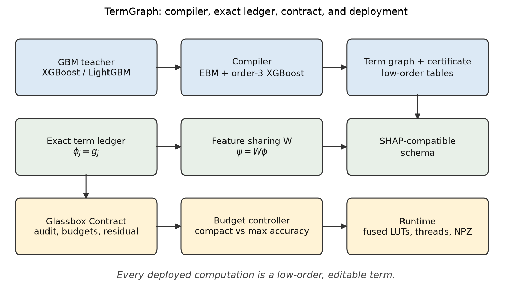
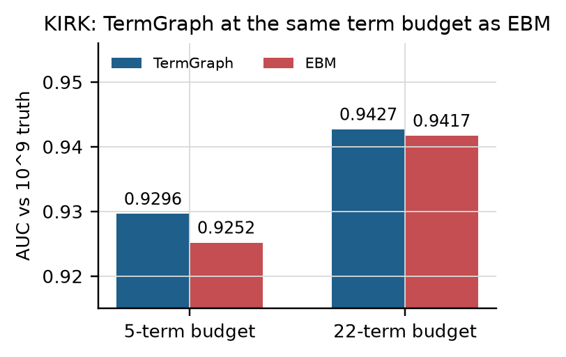
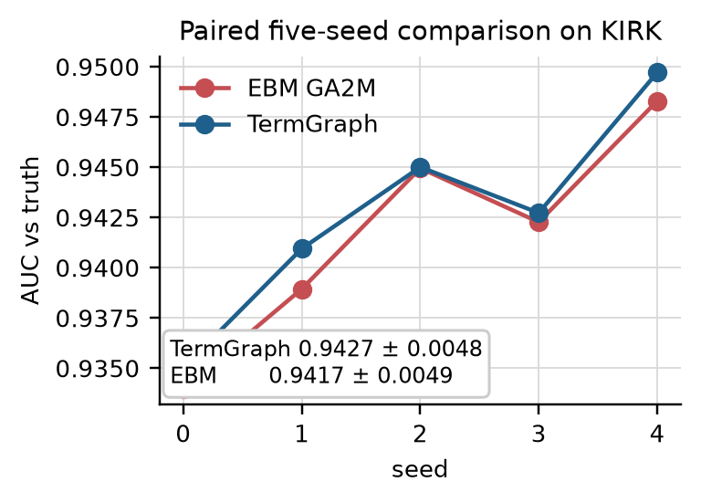
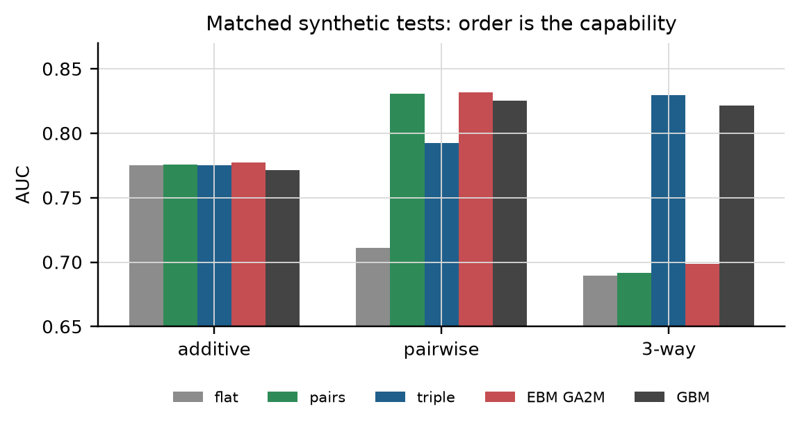
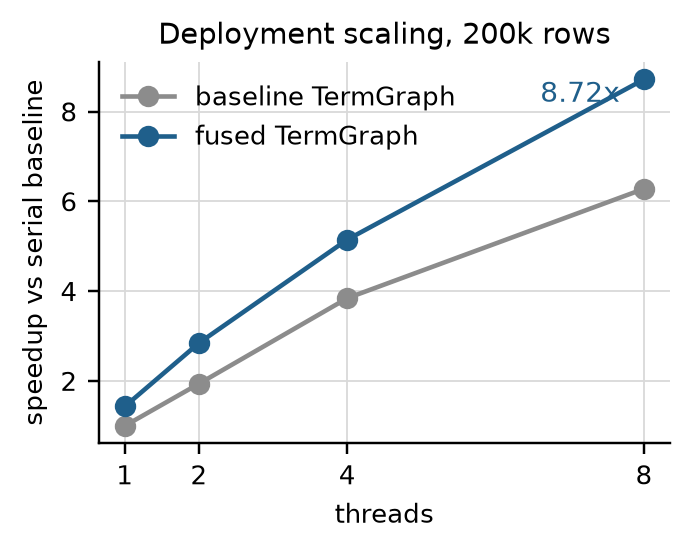
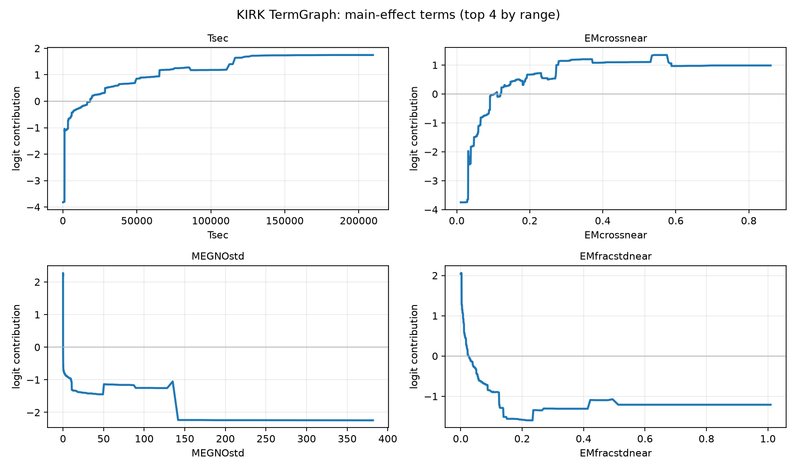
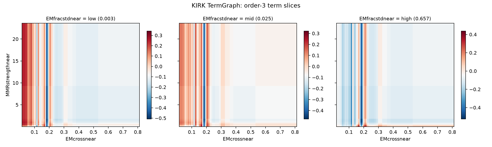

<div align="center">

# TermGraph

**A certified glassbox exchange layer for GBM-class models.**

[](https://www.python.org/)
[](LICENSE)
[](tests/)
[](paper/main.pdf)
[](https://github.com/AleeeeM2008/termgraph)

</div>

<p align="center">
  
</p>

I built TermGraph around one idea: a glassbox should be an exchange layer, not a
separate model. It compiles a GBM-class model into a sum of low-order table
terms,

```
logit = b + sum_j g_j(x[S_j]),     |S_j| <= 3
```

and keeps the tables, the term ledger, the certificate, and the editor. The
serving artifact is NumPy only. JSON is the editable source and NPZ is the
binary form.

EBM handles the low-order terms well. TermGraph adds order-3 structure and keeps
the term ledger exact. It also declares how features share credit, supports
post-hoc edits, chooses an artifact with a budget controller, and serves from
lookup tables.

## Results

The max model uses an EBM GA2M for low-order terms and one order-3 XGBoost
residual term. The compact model is a five-term partition of the same 11
features. Both pass the Glassbox Contract.

<p align="center">
  
  
</p>

| KIRK result | TermGraph | Baseline |
|---|---:|---:|
| Max accuracy, five seeds | **0.9427 ± 0.0048** | EBM GA2M 0.9417 ± 0.0049 |
| Compact model, five-term budget | **0.9296** | EBM 0.9252 |
| Max model vs NAM | **0.9427** | 0.9206 |
| Controlled three-way test | **0.8297** | EBM GA2M 0.6989 |
| Certified-fold compile error | **5.3e-15** | not applicable |
| Eight-thread runtime | **8.72x**, 5.66M rows/s | serial baseline |
| Certified-fold binary artifact | **0.66 MB** | JSON 6.0 MB |

The max result gains 0.0010 AUC over EBM, and the gain is positive on all five
seeds. The compact result is a structural comparison: EBM needs one term per
feature, so a five-term EBM sees only five of the 11 features. On the controlled
three-way truth, TermGraph is the model that can represent the signal. EBM is
pairwise by construction.

<p align="center">
  
  
</p>

## Design

- The term ledger is exact: `f = b + sum_j phi_j`.
- Feature values use a declared sharing matrix: `psi = W phi`. The default is
  equal split inside a term. This is not full-model Shapley when terms overlap.
- Terms can be zeroed, clamped, monotonized, or replaced. The other terms stay
  fixed.
- The compact and max artifacts are both admissible. The controller selects one
  by term budget.
- Inference is comparisons, table gathers, and adds. There is no dense matrix
  multiplication.

## Install

```bash
python -m pip install -e ".[train,plots,dev]"
```

The runtime needs only NumPy. The training and compiler extras add XGBoost,
InterpretML, scikit-learn, and joblib. The plot extra adds matplotlib.

## Usage

```python
import numpy as np
from termgraph import TermGraph, FastTermGraph

g = TermGraph.from_npz("models/kirk_glassbox.npz")
fast = FastTermGraph(g)

logit = fast.predict(X)
terms = g.term_values(X)                 # exact ledger, shape (n, K)
phi, expected = g.feature_values(X)      # declared equal-split sharing
assert np.allclose(phi.sum(1) + expected, logit, atol=1e-10)

print(g.describe())
```

A term edit touches one term only:

```python
from termgraph import zero_term, diff_graphs

g2 = zero_term(g, "EPstdnear*MEGNO")
delta = diff_graphs(g, g2, X)            # remaining terms: 0.0
```

The controller is a small function over candidate artifacts:

```python
from termgraph import ModelSpec, TermBlock, load_candidate, select

compact = ModelSpec(
    "compact_5term",
    "models/kirk_glassbox_compact.json",
    [TermBlock("five_terms", "auto", "table", "xgboost", max_order=3)],
    expected_auc=0.9296,
    max_order=3,
)
maximum = ModelSpec(
    "max_accuracy_22term",
    "models/kirk_glassbox_full.json",
    [TermBlock("max", "auto", "table", "ebm", max_order=3)],
    expected_auc=0.9427,
    max_order=3,
)
candidates = [load_candidate(compact), load_candidate(maximum)]
chosen = select(candidates, term_budget=5)
print(chosen.spec.name)                  # compact_5term
```

## Reproduce the plots

Every figure is regenerated from saved result JSONs and certificates. This does
not retrain a model, run an N-body integration, or require the external data.

```bash
python scripts/reproduce_plots.py
```

The script writes the nine figures under `assets/figures/`, including the
architecture diagram, budget and seed comparisons, synthetic test, scaling,
editing, and the term plots.

## Reproduce the paper

```bash
cd paper
latexmk -pdf -interaction=nonstopmode main.tex
```

`paper/main.pdf` is the compiled ten-page JMLR-format preprint. The style file
is vendored at `paper/jmlr2e.sty`. `make paper` runs the same command from the
repository root.

## Reproduce the artifacts

The KIRK data and SPOCK teacher are external. Set `KIRK_ROOT` to the checkout.
The configuration in `configs/kirk.json` holds the seeds, blocks, grid sizes,
EBM and XGBoost settings, and budgets.

```bash
export KIRK_ROOT=/path/to/kirk-data
python scripts/train_kirk.py --mode compact
python scripts/train_kirk.py --mode max
```

The script writes `*_retrained` artifacts and certificates. Edit the config to
change any training parameter. The scripts under `experiments/legacy/` are the
frozen record that produced the checked-in JSONs. They are not the supported
training path.

## Repository layout

```
src/termgraph/        IR, contract, controller, compiler, runtime
experiments/          final report, shared loader, saved result JSONs
experiments/legacy/   frozen historical scripts with fixed constants
models/               deployable artifacts and certificates
assets/figures/       publication figures
paper/                LaTeX manuscript and compiled PDF
scripts/              plot reproduction, training, and release checks
tests/                unit, contract, controller, and artifact tests
configs/              training configuration
```

## Limits

EBM GA2M beats the compact five-term model on raw KIRK AUC (0.9417 against
0.9364 for the earlier full-capacity five-term experiment). The compact artifact
reported above is 0.9296. TermGraph is not universally more accurate.

The max artifact is exact for a declared EBM term set, not a canonical
functional-ANOVA decomposition. The compact artifact is a partition and is the
cleaner formal object. Feature sharing is a convention; the term ledger is the
exact part.

The real-data evidence is one task. The three-way result is a controlled
benchmark. The 3D term is inspected through slices, not as a full table. This
release does not include a human user study, a categorical benchmark, a
multi-class objective, or training on the full 100k archive.

<p align="center">
  
</p>

<p align="center">
  
</p>

## Paper and release

- [`paper/main.pdf`](paper/main.pdf): compiled manuscript.
- [`paper/main.tex`](paper/main.tex): LaTeX source.
- [`ARCHITECTURE.md`](ARCHITECTURE.md): concise design note.
- [`experiments/RESULTS.md`](experiments/RESULTS.md): experimental record.
- [`RELEASE.md`](RELEASE.md): v0.1.4 notes.
- [`SHA256SUMS`](SHA256SUMS): release checksums.

```bash
make checksums
```

## Citation

```bibtex
@misc{merycaro2026termgraph,
  title  = {TermGraph: A Certified Glassbox Exchange Architecture for GBM-Class Models},
  author = {Mery Caro, Patricio Alejandro},
  year   = {2026},
  note   = {Independent Researcher, La Serena, Chile},
  url    = {https://github.com/AleeeeM2008/termgraph}
}
```

## Author

**Patricio Alejandro Mery Caro**  
Independent Researcher, La Serena, Chile  
[pmery641@gmail.com](mailto:pmery641@gmail.com)

## Disclaimer

This code was assisted by DeepSeek V4.1 Flash to speed up investigation. The
architecture, logic, experiment design, and verification were human-designed and
reviewed; the assistant was used for implementation, plotting, and manuscript
drafting. All reported results are reproducible from the included artifacts and
scripts.
